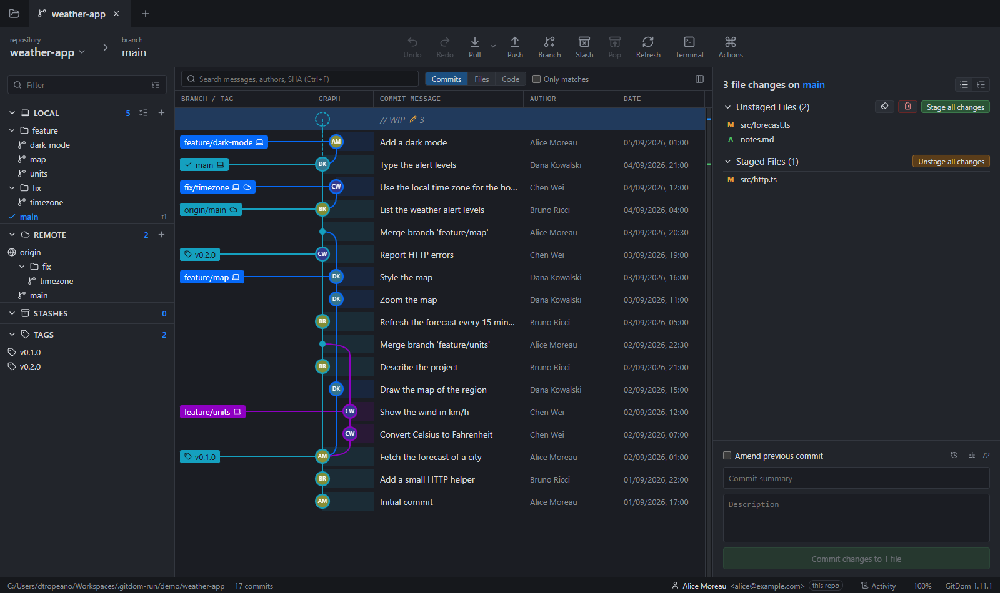
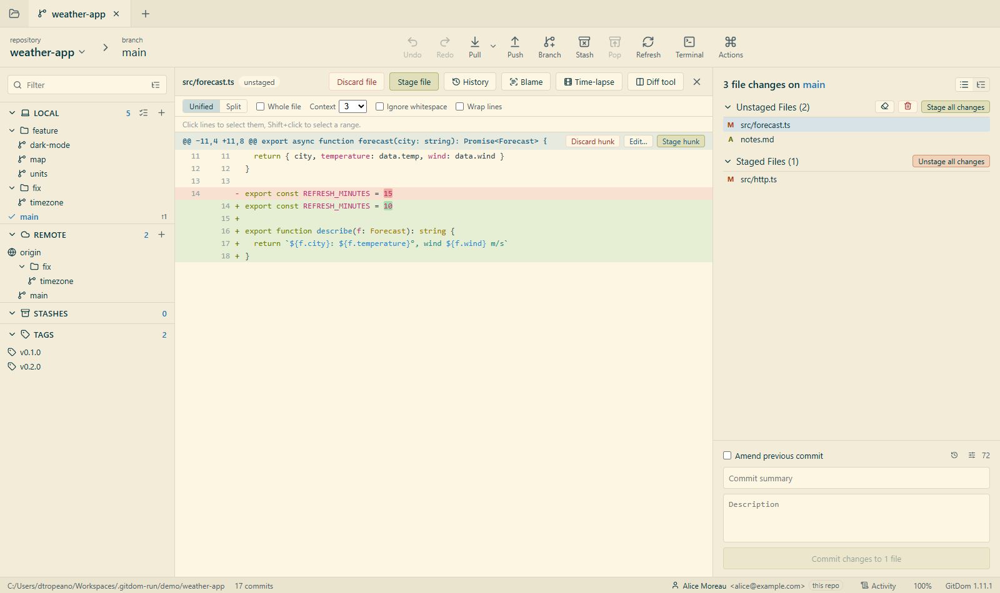
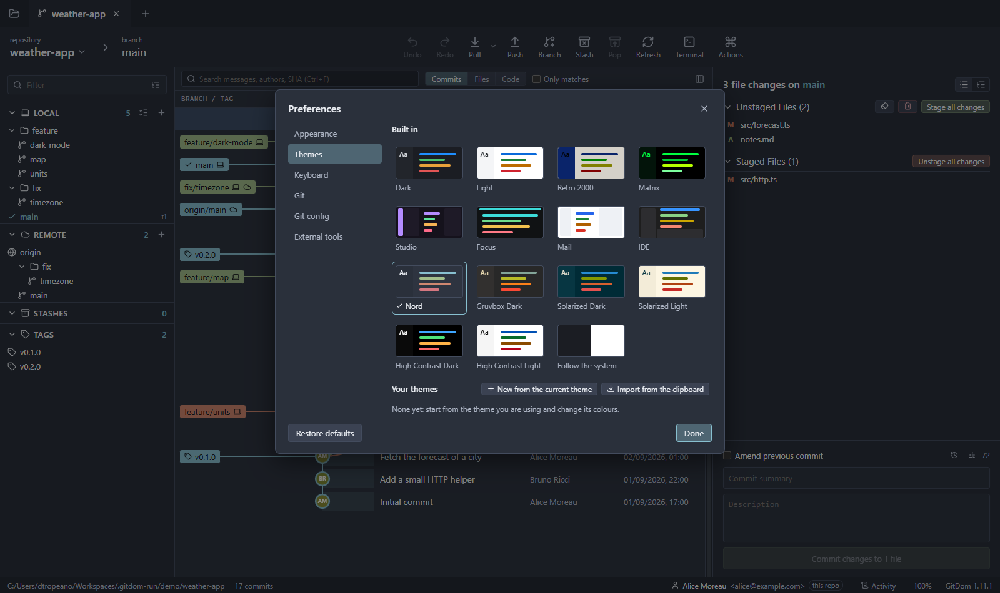
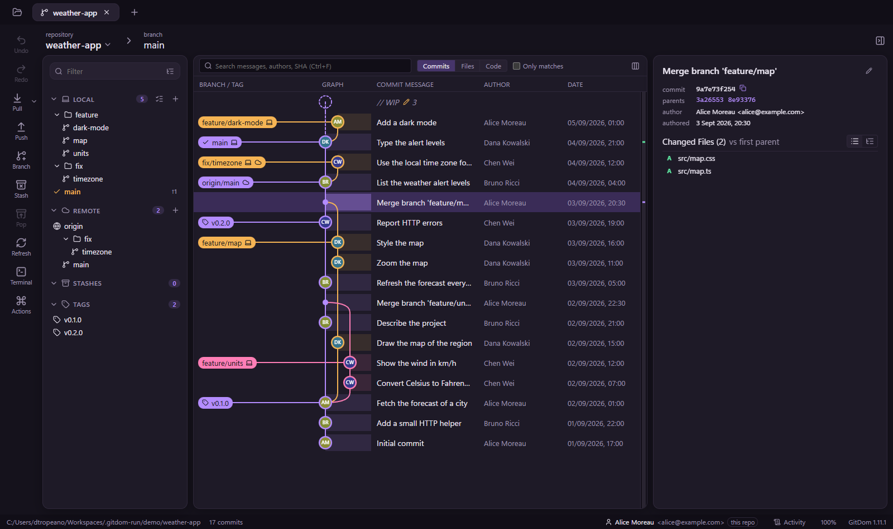
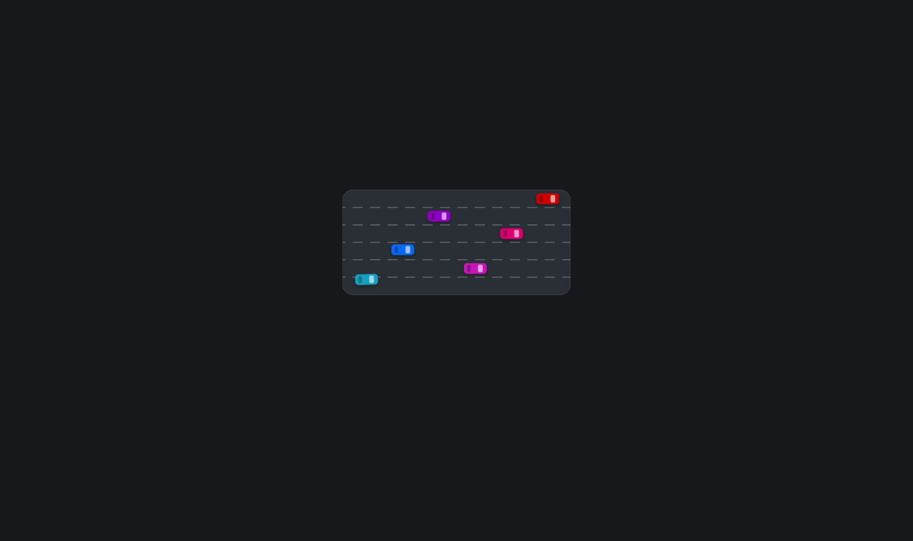

# GitDom

**A desktop Git client with an interactive commit graph.**
Many authors, one flow.

[](https://github.com/oromis95/gitdom/actions/workflows/ci.yml)
[](https://github.com/oromis95/gitdom/releases/latest)
[](LICENSE)

GitDom is a graphical client for everyday Git work: you can browse history, stage lines, merge, rebase and resolve conflicts from one window. It runs your installed `git` command line, so your hooks, config, credential manager, SSH keys and LFS work the same way they do in the terminal.



## Highlights

- A [commit graph](#commit-graph) that stays smooth on histories of a million commits, with search, a minimap and drag and drop between branches
- [Staging](#staging-and-committing) of files, hunks or single lines, with checks for secrets and big files before you commit
- [Interactive rebase, fixup, split and reorder](#rewriting-history), with an automatic [backup and undo](#safety-net) for every risky operation
- A [time-lapse](#history-and-code-archaeology) of any file, blame back in time, the history of a function, and bisect
- [Pull requests](#pull-requests) of GitHub, GitLab, Bitbucket (Cloud and Data Center) and Azure DevOps on the branches of the graph, with their reviews, checks and changes read in GitDom's own diff
- [Statistics](#statistics-and-maintenance), a [dashboard of all your repositories](#several-repositories) and a weekly summary of what you did
- [Themes](#themes) from Nord to Retro 2000, four that rearrange the whole window, and your own
- Windows, macOS and Linux, with [updates](#updates-and-help) that install themselves

## Contents

- [Download](#download)
- [Features](#features)
- [Privacy](#privacy)
- [Building from source](#building-from-source)
- [How it's built](#how-its-built)
- [Status](#status)
- [License](#license)

## Download

The [Releases](https://github.com/oromis95/gitdom/releases) page has a version for each system. All need [Git](https://git-scm.com/) on the `PATH`.

**Windows** 10 or 11: two versions, which update themselves and share settings, tabs and themes.

- **Installer** (`GitDom-<version>-setup.exe`, recommended): installs GitDom for your user only, in `%LOCALAPPDATA%\Programs\GitDom`, with no administrator rights, and adds it to the Start menu and the desktop. It starts quickest, because nothing is unpacked at each start.
- **Portable** (`GitDom-<version>-portable.exe`): a single exe that you start with a double-click, with nothing to install. At each start it unpacks itself to a temporary folder, so it takes a few seconds longer to open.

**macOS** 12 or later: `GitDom-<version>-arm64.dmg` for Apple Silicon, `GitDom-<version>-x64.dmg` for Intel Macs. Drag GitDom to Applications. It isn't signed by a registered Apple developer, so the first time right-click it and choose **Open** (or run `xattr -cr /Applications/GitDom.app`).

**Linux** (64-bit): `GitDom-<version>-x86_64.AppImage` runs without installing (make it executable first); `GitDom-<version>-amd64.deb` installs on Debian and Ubuntu. On Ubuntu 24.04 and later the AppImage may need `--no-sandbox`, as AppArmor restricts the sandbox of apps not installed as packages; the deb doesn't.

Windows is used every day; macOS and Linux run the automated tests, including the end-to-end ones, at every push.

## Features

### Opening a repository

- Open a local repository, clone one from an HTTPS or SSH URL, or create a new one (**File** menu)
- Clone with a progress bar and a Cancel button; you can pick a branch, a shallow depth, and whether to clone submodules
- New repositories can start with a `.gitignore` template, a README and a license, in a first commit
- Recent repositories on the start screen, with favorites pinned at the top

### Commit graph

- Virtualized canvas graph with colored lanes and branch/tag labels, smooth at 60fps
- Histories of any size: the latest 10,000 commits load at once, older ones as you scroll (tested on a million commits)
- Local and remote branches that point to the same commit share one label
- Search by message, author, SHA or changed file (Ctrl+F), with matches highlighted, Enter to step through them, and an option to list only the matches
- Hide a branch from the graph, or show only one branch, from its right-click menu
- Resizable columns, an optional SHA column, and right-click the header to hide columns
- Author pictures from Gravatar (or GitHub for its noreply addresses), with initials when offline
- Stashes drawn as nodes on the commits they were made on
- Hover a branch label to highlight its line; a minimap beside the graph marks HEAD, the selection and the search matches
- Commit details, changed files as a list or a folder tree, and diffs with syntax highlighting

### Diffs

- Unified or split (side by side) view, with the changed words highlighted inside each line
- Show the whole file with its changes, choose the context lines, ignore whitespace, wrap long lines
- Compare any two commits (Ctrl+click both in the graph), or a branch or tag with the current branch
- Images compared side by side, overlaid with an opacity slider, or with a swipe
- Open any change in your external diff tool (WinMerge, Beyond Compare, VS Code…)



### Staging and committing

- Stage and unstage whole files, single hunks or single lines; discard all the changes at once
- Edit a hunk before staging it: stage the lines as they should be, while the file on disk keeps its changes
- Commit, amend, and a WIP row for your uncommitted changes
- Commit options: skip the hooks (`--no-verify`), sign, commit as another author
- Checks before committing: secrets, big files and binaries outside LFS, leftover `console.log` and TODOs, the message style; warnings only, each kind can be turned off
- Commit message template (`commit.template`) and quick reuse of a recent message
- Edit the message of any commit on the current branch from its details (reword); the commit hooks run as with git, so `commit-msg` can check or complete the new message
- Sign commits and tags with GPG, SSH or X.509 keys, and see whether each signature is verified
- Add a file, its extension or its folder to `.gitignore` from the file's menu, and see which rule ignores a file, and from which file and line
- Clean up untracked and ignored files: a preview with sizes, then to the Recycle Bin or deleted for good

### Branches, tags and stashes

- Branches, checkout, tags and stashes from the sidebar, shown as folders (`feature/…`) or as a flat list; check out a tag to look at that version
- Stash everything, only the staged changes, or a single file; optionally stash automatically on checkout
- Branches overview (**View → Branches Overview**, or the list button on the Local section): each branch with its age, how far ahead and behind main it is, and whether it is merged, squash-merged or its upstream is gone; tick the old ones and delete them at once, with a backup and Undo
- Worktrees: check out a branch in its own folder, listed in the sidebar, to work on two branches at once
- Release notes: the commits between two tags (or since the last one), grouped by type into Markdown ready to copy

### Remotes and credentials

- Pull as set in git (`pull.rebase`, `pull.ff`), or with merge, fast-forward only or rebase; push, and a periodic background fetch
- Push with a progress bar under the toolbar: it fills as git counts, compresses and sends the objects, with the amount sent and the speed in the status bar and the percentage on the Push button. Fetch, pull and the other long operations show a moving bar
- The first push of a branch creates it on the remote and makes it follow it there. The remote is the one git would choose: the branch's `pushRemote`, `remote.pushDefault`, the remote of its upstream, the only remote, `origin`. With several remotes and none of them `origin`, GitDom asks where to push. It follows `push.default`: a branch following one with another name (one created from `origin/main`) doesn't push onto it, as git refuses, and GitDom asks where to push instead
- Credentials when git needs them: a username with a password or token, an SSH key's passphrase, or whether to trust a server seen for the first time, asked in a GitDom dialog. Your credential helper keeps them, if you have one; GitDom stores nothing. The periodic fetch never asks: if it needs credentials it says so once, and **Fetch** asks

### Pull requests

GitHub (and GitHub Enterprise), GitLab (gitlab.com or your own server), Bitbucket Cloud, Bitbucket Data Center and Azure DevOps (and Azure DevOps Server).

- **Connect** in the **Pull Requests** section of the sidebar. If you already push over HTTPS, GitDom uses the token Git Credential Manager keeps for the host, and asks nothing (this works for GitHub, Azure DevOps and Bitbucket Data Center, where it's your username and password or token; GitLab's and often Bitbucket Cloud's can't read pull requests); otherwise paste a token, with your Atlassian account's email for a Bitbucket Cloud API token, or an HTTP access token on Bitbucket Data Center. The dialog says which permissions to tick and opens the page to create it. Tokens are encrypted with the system's keychain and only sent to their service; Git Credential Manager's aren't copied at all
- The section lists the open pull requests (merge requests on GitLab) in **Mine**, **Review requested** and **Others**, with their checks, comments and your review, kept up to date while GitDom is in use
- On the graph, the branch of a pull request shows a badge with its number, coloured by its state (draft, open, approved, changes requested, conflicts), and a dot for its checks. Resting the mouse on it shows who opened it, the reviewers and their verdict, the failing checks and whether it can be merged
- Checks are GitHub's checks and statuses, GitLab's pipeline jobs, Bitbucket's build statuses, and on Azure DevOps the pull request's statuses and build policies; Azure DevOps' other policies (reviewers, comments, work items) and Bitbucket Data Center's merge checks say why a pull request can't be merged yet
- Click a pull request to open it in place of the graph: its description and conversation, reviewers, checks with links to their logs, commits, and whether it can be merged, with the reason when it can't. Its commits are fetched into the repository (also from forks), and its changes are listed in the detail panel and read in GitDom's diff, from where it left the target branch as the service shows them
- **Create a pull request** from the **+** of the Pull Requests section, a branch's menu, the command palette, or the button of the toast after pushing a branch that has none. The dialog proposes the target branch (the repository's default one), a title from the only commit or the branch name, the repository's description template (or the list of the commits), reviewers searched among the repository's people, labels, draft or not, and shows the commits it brings. A branch not pushed yet is pushed first. On Bitbucket Data Center the repository's default reviewers are added too, as on its own page
- In a pull request's view: **Merge…** with the methods the repository allows (merge commit, squash, rebase, fast-forward), the commit message, deleting the source branch, or merging by itself once the checks pass and the reviews are in (GitHub, GitLab, Azure DevOps, and Bitbucket Data Center where auto-merge is on); afterwards GitDom offers to switch to the target branch, pull it, and delete the local branch. **Check out** makes a local branch following the pull request's branch, so pushing updates it; from a fork, GitDom offers to add the fork as a remote, or takes its commits on a branch `pr/<number>`. **Worktree** opens it in a folder of its own. **Ask to review**, and under **More**: edit the title and description, ready for review or back to draft, close it (and open it again)
- Every open pull request is in the command palette, with **Refresh pull requests**
- **Preferences → Accounts**: the connected accounts, to disconnect them; the badges on or off; your own servers (GitHub Enterprise, self-managed GitLab, Bitbucket Data Center, Azure DevOps Server) as `host kind` lines. Bitbucket Data Center is recognized by itself from its `/scm/` addresses and SSH port 7999; a line is needed only for other SSH ports

### Merging and conflicts

- Merge and rebase, or drag a branch onto another to fast-forward, merge or rebase
- Conflict preview: the merge and rebase dialogs say which files will conflict, and a warning beside the branch shows when it and main changed the same lines
- A conflict resolution view, or your own merge tool on a conflicted file
- Cherry-pick, revert and reset (soft, mixed, hard)

### Rewriting history

- Interactive rebase
- Reorder the commits of the current branch by dragging them in the graph
- Fixup: add the staged changes to an older commit of the current branch, keeping its message
- Split a commit in two, file by file, each with its own message
- Commits made on the wrong branch: move them to a new branch or onto another one, and the current branch goes back to before them
- Patches: save a commit, several commits picked with `Ctrl`+click, or the uncommitted changes as a `.patch` file, or copy them; apply one with **File → Apply Patch…** or by dropping it on the window. GitDom shows its commits and files and whether it applies first, then applies it as commits with their author and message (`git am`), to the working tree, or staged

### Safety net

- Undo / redo of the last operations
- Automatic backup of the branch before a reset, a rebase or a force push; restore it with one click or create a branch from it (**View → Backups**)
- Reflog of HEAD and of each branch, to find commits lost after a reset or a rebase (**View → Reflog**)
- Activity log (**View → Activity Log**, `Ctrl+Shift+L`): every git command GitDom runs, grouped by action, with its duration, result and output

### History and code archaeology

- Blame and file history
- History of some lines or of a function: pick the lines in the blame, or type the function's name, and see every commit that changed them
- Search the code (**Code** beside the graph search): the commits where some text appeared or went away, or whose changed lines match a regular expression
- A file as it was at a commit (**File** in the file inspector): with highlighting or as an image, and **Save as…** to keep a copy
- Blame back in time: from a line of the blame, the file just before that commit changed it, at the same place, and back again
- Time-lapse of a file (**Time-lapse** in the file inspector, or on a file's right-click menu): drag the timeline under the code and the file changes version by version at once, with who changed each line. Recent changes stand out and fade as you move on, and the lines each commit removed stay in sight in red
  - Click a line to anchor it: it stays in place while you scrub, and the timeline marks the versions that have it
  - Search as you type: the timeline marks the commits that add or remove the text, or whose message or author has it (Enter or F3 for the next one)
  - Tags on the timeline, and a bookmark (M, then ' to jump back and forth) to open two versions in your diff tool
  - Keys: ← → step one commit (Shift for ten), Home and End, R recency, G removed lines, X tags, / search
- Find where a problem started (bisect): right-click a commit that has it, then one that didn't; GitDom checks out commits halfway between and you answer **Good** or **Bad** until it names the commit that brought the problem in. **Skip** the ones that can't be tested, or let a command such as `npm test` answer for you

### Statistics and maintenance

- Statistics (**View → Statistics**): commits, authors and their share, an activity calendar, commits per month with the growth of the code, the hours commits are made, and the languages of the project
- Hot files, changed most and most recently, and the files only one person knows, with the bus factor
- For the current branch or all of them, over any period; reading a big history can be stopped
- Repository health (**View → Repository Health**): what the history takes on disk, packed and loose, the heaviest files ever committed (even deleted ones), and one-click `git gc`, `git prune` and `git fsck`
- Hooks (**View → Hooks**): every git hook with when it runs; edit the scripts, start from git's examples, turn them off and on without losing them, and run pre-commit to try it. GitDom warns when Husky, Lefthook or `core.hooksPath` manage them

### Several repositories

- Several repositories open side by side in tabs. A repository opens in its tab at once, with a loading animation while its history is read: new cars keep coming in and getting in a row. Right-click a tab to close it, the others, those to its right or left, or all of them, or to copy its path or show it in its folder
- Quick switcher on the repository name in the toolbar: open tabs, favorites and recent repositories, with search
- Workspaces: save the open tabs under a name and reopen them together
- Workspace dashboard (**View → Workspace Dashboard**, or **Dashboard** on the welcome screen): every repository you have open, saved in a workspace, favorite or recent, with its branch, commits to push and to pull, changes, stashes, and anything stuck such as a merge in progress. **Fetch all** fetches them a few at a time, **Pull** fast-forwards those that are only behind, and a click opens one
- What I did (**View → What I Did**): your commits this week, last week or in the last 7 or 30 days, in every repository GitDom knows, by day and repository, on any branch; copy them as text or Markdown for a standup or a report, or click one to open it. Yours are those with the repository's author email or one of your identity profiles

### Tools and integrations

- Integrated terminal (`` Ctrl+` ``) that opens in the repository
- Submodules: status, add, initialize, update and sync their URLs
- Git LFS: tracked patterns, LFS badges on files, track or untrack from the file list, download and upload the LFS files
- Author identity per repository or global, with saved profiles to switch between
- Open a file in your editor (VS Code or any command you choose) or show it in Explorer (Finder on macOS)

### Keyboard and command palette

- Command palette (`Ctrl+Shift+P` or `Ctrl+P`) for every action
- Every shortcut is listed in **Preferences → Keyboard**, where you can give it other keys or remove them
- Move between the panels with `Ctrl+1` (sidebar), `Ctrl+2` (graph) and `Ctrl+3` (details); `Ctrl+Alt+F` filters the sidebar
- In the graph, the arrow keys, Page Up/Down, Home and End move the selection, and Enter goes to the details
- In the sidebar and the file lists, the arrow keys move between the items; Enter checks out a branch or opens a file's diff, and `Space` stages or unstages the file
- `Alt+Down` / `Alt+Up` (or `F7` / `Shift+F7`) jump to the next or previous change in a diff
- The menu key or `Shift+F10` opens the right-click menu of the selected item, and the arrow keys move through it

On macOS the shortcuts use ⌘ in place of `Ctrl`.

### Preferences

Open them with **File → Preferences** or `Ctrl+,`.

- Interface and code fonts, code text size
- Zoom the whole interface with `Ctrl+=` / `Ctrl+-` / `Ctrl+0` or `Ctrl`+mouse wheel; the status bar shows the level
- Drag the edges of the side panels to resize them; GitDom remembers the sizes (double-click an edge to reset it)
- Background fetch interval (or off), default pull strategy, automatic stash on checkout
- Path of the git executable, external editor, merge tool and diff tool
- **Accounts**: the services connected for [pull requests](#pull-requests), and servers of your own
- **Git config**: see and edit your global git settings and those of the open repository, with a filter
- Startup check for new versions
- **Export Settings…** and **Import Settings…** in the **File** menu: every setting in one file, to keep or to take to another computer. GitDom keeps them in `settings.json`, in its folder (`%APPDATA%\GitDom` on Windows)

### Themes

- Dark, Light, or follow the system setting
- **Retro 2000**: the grey raised and sunken bevels of the desktops of 2000, with navy title bars, Tahoma and dotted scroll bars
- **Matrix**: green phosphor on black, monospaced everywhere, a faint glow and monitor lines, and falling code on the welcome screen
- **Layout themes**: four themes that also arrange the panels their own way, each with its own colors
  - **Studio**: floating rounded panels, actions in a rail on the left and a collapsible detail panel
  - **Focus**: just the graph, with one slim bar of icons; the branches slide in from the left when you need them, and the detail opens beside the graph when you select a commit
  - **Mail**: three columns like an email client, on a light background: the branches as folders, the commits as a list and a wide reading pane; a diff opens in the reading pane, with the files of the commit in the middle
  - **IDE**: the colors of a code editor, with the graph on top and a panel at the bottom holding the detail and the diff side by side; drag its edge to resize it
- Ready-made themes: Nord, Gruvbox Dark, Solarized (dark and light), and high-contrast dark and light
- **Your own themes**: start from any theme and change its colors in **Preferences → Themes**; GitDom checks that text stays readable (WCAG contrast) and warns you if it doesn't. Themes can be exported and imported as text through the clipboard
- To switch theme, use **Preferences → Themes**, **Window → Theme** or the command palette





At startup GitDom shows its logo: cars on a six-lane highway, like changes from many authors, come in all together, overtake one another and brake, until a light runs over the road and puts them in a row, without one ever touching another. Click or press any key to skip it. You can also turn it off in Preferences or from the command palette.

<p align="center"></p>

### Updates and help

- At startup GitDom tells you when a newer version is out on GitHub
- **Update** downloads it in the background and checks it against the release's SHA-256; it's installed when you close GitDom, or right away with **Restart now**
  - Installed GitDom: the new installer runs silently, and **Restart now** opens the new version when it's done
  - Portable exe: the new exe takes the old one's place, keeping its name and folder, so your shortcuts keep working
- If the download is blocked, or GitDom's folder isn't writable, **Download** opens the release page instead
- On macOS and Linux GitDom tells you when a new version is out, and **Download** gets the file for your system
- **Help → What's New** lists what each version added; the full list is in [CHANGELOG.md](CHANGELOG.md)
- **Tips** explain a feature at a time with a small animation: one at startup, and one now and then right after doing something it builds on. **Help → Tips** lists them all; they can be turned off from the dialog or in Preferences

## Privacy

GitDom has no account, no telemetry and no server of its own. Besides the git commands you run, it goes online only for:

- **Author pictures**: looked up on Gravatar (or GitHub, for its noreply addresses) from a hash of the author's email. Turn them off in **Preferences → Author pictures**
- **Updates**: the startup check reads the latest version from GitHub. Turn it off in Preferences
- **Pull requests**: only for a service you connected, GitDom reads the pull requests of the open repository from it, about once a minute while GitDom is in front. **Disconnect** in **Preferences → Accounts** stops it

## Building from source

You need [Git](https://git-scm.com/) on the `PATH` and [Node.js](https://nodejs.org/) 22 or later.

```bash
git clone https://github.com/oromis95/gitdom.git
cd gitdom
npm install
npm run dev
```

| Command                              | What it does                                        |
| ------------------------------------ | --------------------------------------------------- |
| `npm run dev`                        | Starts the app in development mode, with hot reload |
| `npm start`                          | Builds and starts a production preview              |
| `npm test`                           | Runs the unit and integration tests (Vitest)        |
| `npm run test:e2e`                   | Builds the app and drives it with Playwright        |
| `npm run lint` / `npm run typecheck` | Checks code style and types                         |
| `npm run build:unpack`               | Builds a standalone app folder in `dist/`           |
| `npm run build:win`                  | Builds a Windows installer                          |
| `npm run build:portable`             | Builds a single self-contained Windows exe          |
| `npm run build:release`              | Builds both, as the release workflow does           |
| `npm run build:mac` / `build:linux`  | Builds the macOS disk images / Linux packages       |

## How it's built

- **Electron** with **electron-vite**
- **React** + **TypeScript** for the interface, with **Zustand** for state
- **Canvas 2D** for the commit graph, **highlight.js** for diffs, **xterm.js** + **node-pty** for the integrated terminal
- Git runs as child processes of the main process. Its output is parsed and sent to the interface over IPC; long computations (the time-lapse, the statistics) run in a worker thread, so the main process keeps answering
- The interface runs in Chromium's sandbox and reaches git only through the typed API of the preload script

```
src/
  main/       Electron main process: git commands, file watcher, terminal, menu,
              pull requests of the services (forge/)
  preload/    Bridge that exposes a typed API to the interface
  renderer/   React interface: graph, panels, diff, dialogs, themes
  shared/     Types and helpers shared by both sides
e2e/          End-to-end tests of the built app
bench/        Timing of big repositories
resources/    The askpass helper git and ssh call for credentials
docs/         Requirements and roadmap (Italian), screenshots
```

### Tests

- **Vitest** unit and integration tests, run against real temporary repositories
- End-to-end tests that drive the built app with **Playwright**
- GitHub Actions runs them at every push on Windows, Linux and macOS, together with formatting, lint, types and a build; a release is published only when they pass
- `GITDOM_BENCH=<path> npx vitest run bench` times the loading of a big repository (and with `GITDOM_BENCH_FILE=<file>`, its time-lapse)

## Status

GitDom is a personal project under active development. The latest version is on the [Releases](https://github.com/oromis95/gitdom/releases/latest) page, and what each version changed is in [CHANGELOG.md](CHANGELOG.md).
The full list of requirements is in [docs/REQUISITI.md](docs/REQUISITI.md), and the plan for the next versions is in [docs/ROADMAP.md](docs/ROADMAP.md) (both in Italian).

## License

[MIT](LICENSE)
